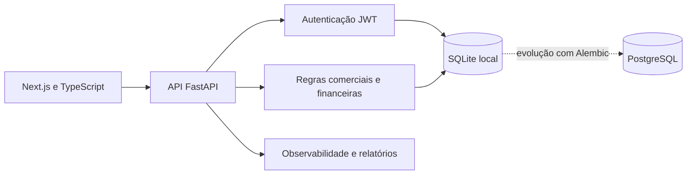

# ConstruStock | Estudo de caso

> ERP SaaS multiempresa para rotinas comerciais, financeiras e administrativas.

[Voltar ao perfil](../README.md)

## Problema

Empresas que controlam vendas, estoque e financeiro em ferramentas separadas perdem rastreabilidade e repetem lançamentos. Um ERP precisa centralizar essas rotinas e manter os dados de cada empresa isolados.

## Solução

O ConstruStock combina uma API FastAPI com uma interface Next.js. O projeto organiza autenticação, regras de negócio, relatórios e estrutura de cobrança em uma arquitetura preparada para migrar do ambiente local para PostgreSQL.

## Decisões de engenharia

- **Separação por empresa:** consultas e regras trabalham dentro do contexto do tenant.
- **Migrações versionadas:** Alembic prepara a evolução controlada do banco.
- **Ambiente reproduzível:** Docker Compose reúne os serviços necessários.
- **Validação de contrato:** o frontend passa por typecheck e build antes da entrega.
- **Preparação operacional:** o projeto inclui guias de arquitetura, deploy e operação.
- **Privacidade:** a modelagem considera fundamentos da LGPD.

## Escopo funcional

- dashboard operacional;
- rotinas comerciais;
- estoque e catálogo;
- financeiro e relatórios;
- autenticação JWT;
- estrutura SaaS e cobrança;
- documentação de deploy e operação.

## Estado do projeto

O sistema permanece privado porque contém regras de negócio. Posso apresentar o desenho da API, a estratégia multiempresa, as migrações e os testes em uma entrevista técnica.

## Competências demonstradas

`Python` · `FastAPI` · `Next.js` · `TypeScript` · `JWT` · `SQLite` · `PostgreSQL` · `Alembic` · `Docker`