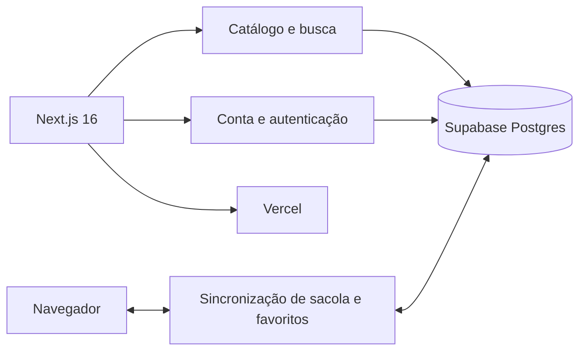

# Nerovant | Estudo de caso

> E-commerce de moda urbana construído com Next.js, TypeScript e Supabase, com catálogo, autenticação e sincronização entre navegador e conta.

[Ver demonstração](https://nerovant.vercel.app) · [Voltar ao perfil](../README.md)

## Problema

Uma loja digital precisa oferecer navegação rápida, busca útil e controle de acesso aos dados. A experiência também deve preservar sacola e favoritos quando o cliente entra em outro dispositivo.

## Solução

O Nerovant usa renderização do Next.js e serviços do Supabase para unir catálogo público, autenticação por link mágico e dados privados protegidos por Row Level Security.

## Decisões de engenharia

- **Catálogo com cache:** páginas e consultas públicas revalidam em intervalos controlados.
- **RLS no banco:** visitantes leem apenas produtos publicados; dados privados seguem políticas por usuário.
- **Autenticação sem senha:** o cliente recebe um link mágico e mantém a sessão renovada pelo servidor.
- **Sincronização previsível:** no login, favoritos são unidos e cada item da sacola preserva a maior quantidade encontrada.
- **Valores monetários em centavos:** o código evita erros de ponto flutuante.
- **SEO técnico:** produtos usam páginas estáticas, canonical, Open Graph e JSON-LD.

## Experiência do usuário

- busca tolerante a acentos e variações de termos;
- filtros armazenados na URL;
- páginas de categoria, coleção e produto;
- sacola e favoritos persistentes;
- conta com dados pessoais e endereços;
- interface responsiva com estados de carregamento.

## Qualidade

O projeto possui scripts de lint, typecheck, build e testes com Vitest e Testing Library. O README privado registra limitações conhecidas e separa o que já funciona do que ainda está em desenvolvimento.

## Estado do projeto

A loja está disponível para demonstração. Checkout, pagamento e administração seguem em desenvolvimento; a versão atual permite avaliar interface, catálogo, busca, autenticação e arquitetura de dados.

## Competências demonstradas

`Next.js 16` · `React 19` · `TypeScript` · `Supabase` · `PostgreSQL` · `RLS` · `Vitest` · `Tailwind CSS` · `SEO`

## Demonstração

[Abrir o Nerovant](https://nerovant.vercel.app)