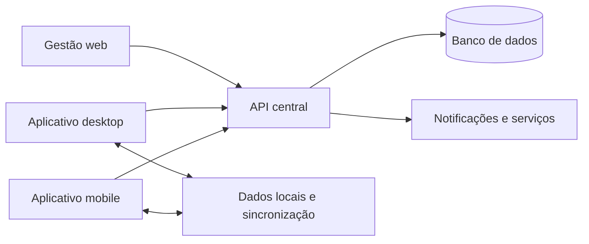

# Velstrix | Estudo de caso

> Plataforma de gestão para barbearias com aplicações web, desktop e mobile, operação offline e separação de dados por empresa.

[Voltar ao perfil](../README.md)

## Problema

Uma barbearia precisa coordenar agenda, clientes, equipe, financeiro e venda de produtos sem interromper o atendimento quando a conexão falha. O sistema também precisa impedir que dados de empresas diferentes se misturem.

## Solução

O Velstrix reúne a operação em uma plataforma SaaS multiempresa. A aplicação combina gestão web, aplicativo desktop e experiência mobile, com uma API central e fluxos preparados para funcionar offline.

## Decisões de engenharia

- **Offline-first:** o atendimento continua durante falhas de conexão e sincroniza quando o acesso retorna.
- **Multiempresa:** cada operação trabalha dentro do seu próprio contexto de dados.
- **Clientes multiplataforma:** web, Electron e mobile compartilham regras e contratos da API.
- **Testes com PostgreSQL real:** os fluxos de concorrência usam o mesmo tipo de banco adotado em produção.
- **Proteção do build:** verificações bloqueiam URLs locais, portas de desenvolvimento e contas de teste em artefatos distribuídos.
- **Auditoria de dependências:** o pipeline reprova vulnerabilidades acima do limite definido.

## Qualidade e entrega

O pipeline de integração contínua cobre cinco áreas:

1. Backend, incluindo testes de concorrência.
2. Aplicação desktop no Windows, com typecheck, testes, build e smoke test.
3. Painel central e geração do renderer Android.
4. Aplicativo mobile, com lint, typecheck, testes e validação do Expo.
5. Contratos de deploy, Docker Compose e scripts de infraestrutura.

Commits de funcionalidades registram o problema, as regras implementadas e os testes adicionados. Um exemplo recente foi a lista de espera para dias sem horário, integrada ao servidor, ao painel de gestão e ao aplicativo do cliente.

## Escopo funcional

- agenda e disponibilidade;
- cadastro de clientes e equipe;
- financeiro e venda de produtos;
- notificações e lista de espera;
- gestão em web e desktop;
- experiência mobile;
- operação offline e sincronização.

## Estado do projeto

Produto privado em evolução contínua. Em uma entrevista, posso demonstrar a arquitetura, os fluxos principais, a estratégia offline e as decisões de testes sem expor regras proprietárias ou dados de clientes.

## Competências demonstradas

`SaaS` · `multi-tenant` · `offline-first` · `Electron` · `React Native` · `Node.js` · `PostgreSQL` · `Docker` · `CI/CD` · `testes de integração`